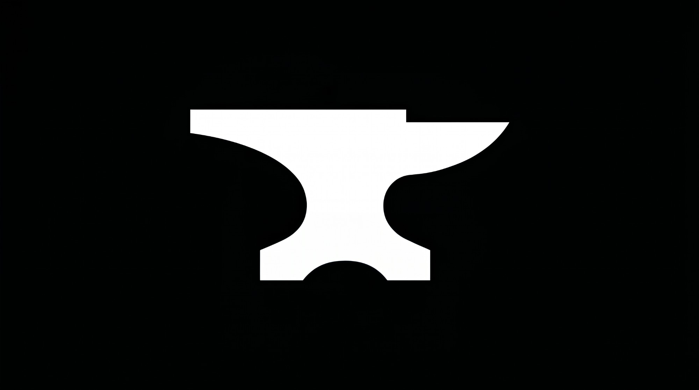
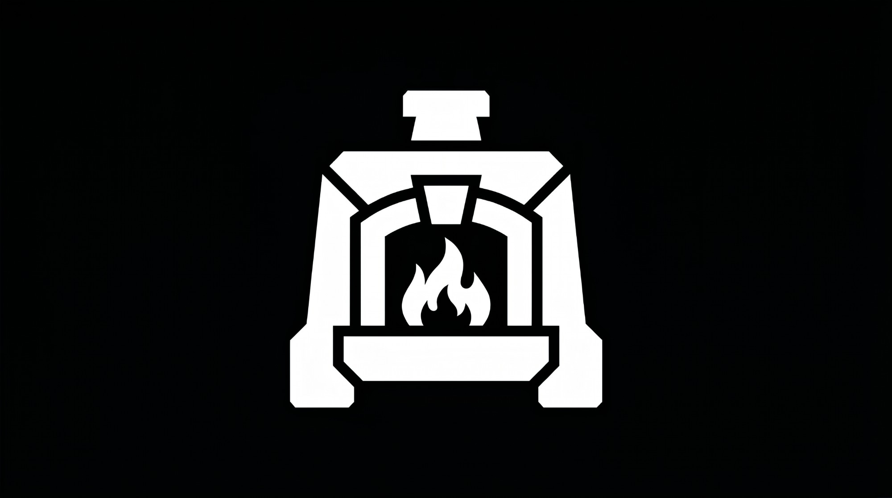

# Identidade visual — Nathanael Industries

| Nome | Logo | Cores | Símbolo | Categoria | Status |
|---|---|---|---|---|---|
| **Bezalel** |  | Preto e verde | Bigorna | Motores (3º motor, criador de IAs) | Conceito |
| **Fornalha** |  | Preto e laranja | Fornalha com chama | Motores (4º motor, transformação) | Conceito |

## Bezalel
- Arquivo: [`logos/bezalel.jpg`](logos/bezalel.jpg)
- Bigorna branca sobre fundo preto. A bigorna é onde o artesão dá forma às peças, assim como o Bezalel dá forma às IAs.
- Cores do tema: **preto e verde**. A versão enviada está em preto e branco.

## Fornalha
- Arquivo: [`logos/fornalha.jpg`](logos/fornalha.jpg)
- Fornalha com chama, branca sobre fundo preto.
- Cores do tema: **preto e laranja**. A versão enviada está em preto e branco.
- **4º motor, de transformação:** fundição de habilidades, prova de fogo e desempenho.

> Bigorna (Bezalel) e fornalha formam o mesmo conjunto de uma oficina de ferreiro.
